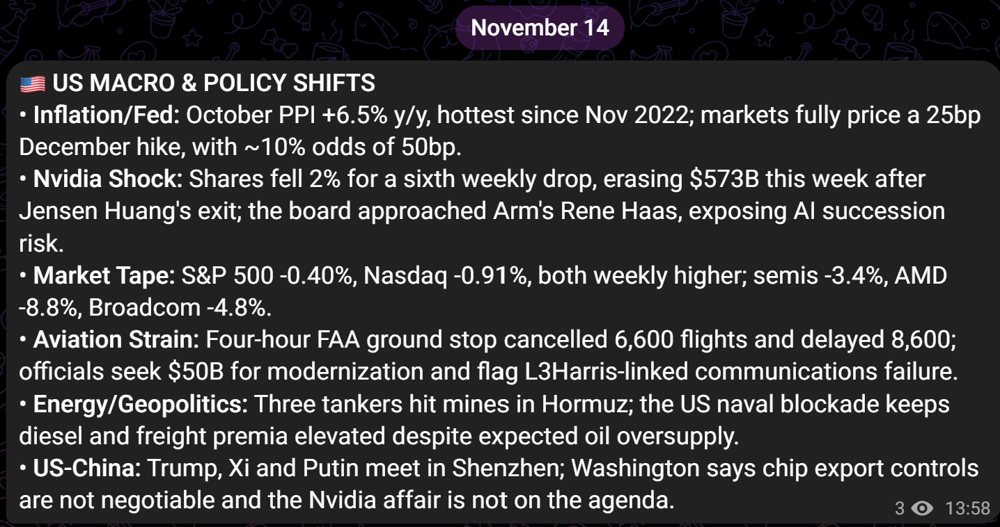
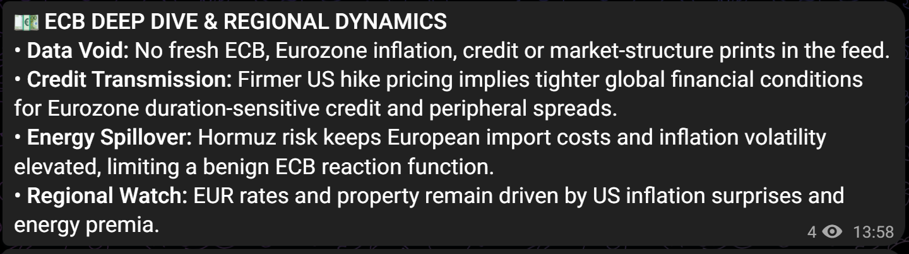
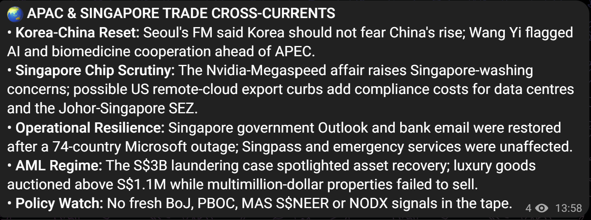
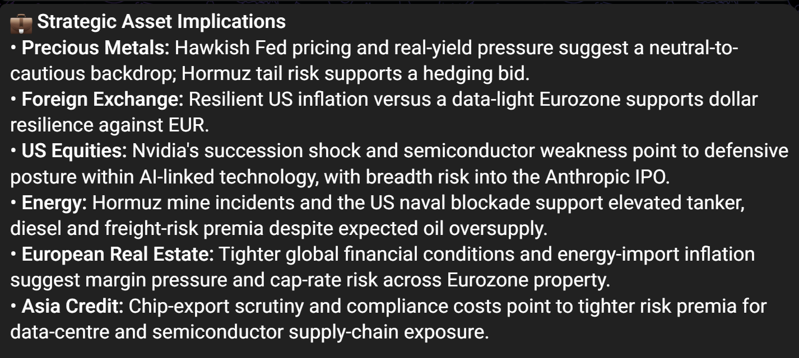
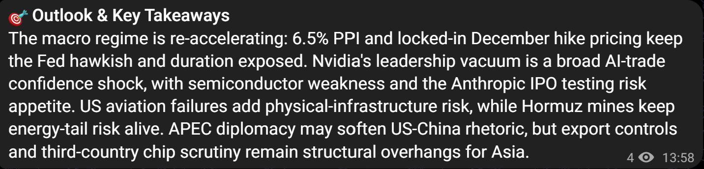
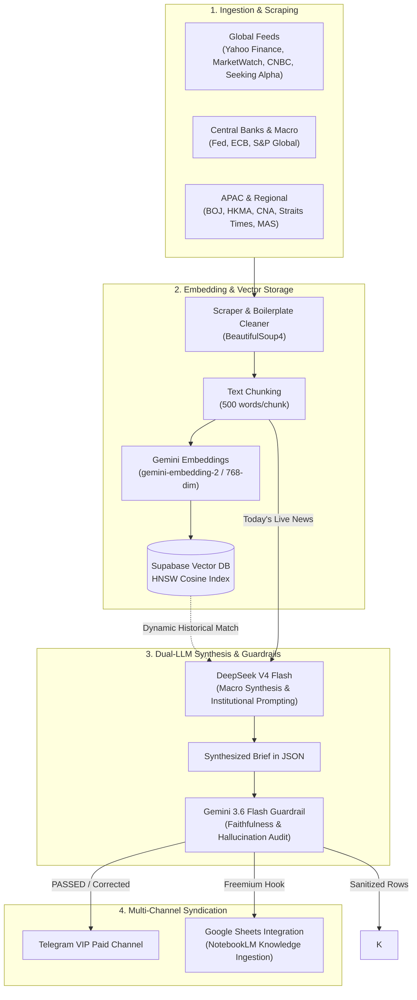

# 🌐 Global Macro Brief & Market Insights Broadcast

[](https://github.com/aientre86/market-insights-broadcast/actions/workflows/schedule.yml)
[](https://www.python.org/)
[](https://opensource.org/licenses/MIT)

An autonomous, macroeconomic intelligence pipeline. It continuously ingests latest RSS feeds from global central banks and tier-1 financial publishers, stores chunked content as high-dimensional vector embeddings in Supabase (`pgvector`), retrieves relevant historical context via RAG, synthesizes actionable market briefs via DeepSeek, and fact-checks candidate briefs with Google Gemini before broadcasting across Telegram channels and Google Sheets.







---

## 📑 Table of Contents

- [System Architecture](#-system-architecture)
- [Key Features](#-key-features)
- [Broadcast Sections & MAS Compliance](#-broadcast-sections--mas-compliance)
- [Repository Structure](#-repository-structure)
- [Prerequisites & Stack](#-prerequisites--stack)
- [Database Setup (Supabase pgvector)](#-database-setup-supabase-pgvector)
- [Environment Configuration](#-environment-configuration)
- [Local Installation & Execution](#-local-installation--execution)
- [GitHub Actions Scheduled Automation](#-github-actions-scheduled-automation)
- [Troubleshooting & FAQs](#-troubleshooting--faqs)

---

## 🏛 System Architecture



---

## 🚀 Key Features

- **Multi-Region Feed Aggregation**: Monitored feeds span US Wall Street, European Central Bank updates, Bank of Japan announcements, Hong Kong Monetary Authority, and Singapore (MAS).
- **Automated Fallback Windows**: Primary sweep targets an 8-hour publication window, auto-expanding to 24–48 hours across weekend market closures.
- **RAG via pgvector & HNSW**: Ingested articles are embedded into 768-dimensional vectors using `gemini-embedding-2` and matched against historical precedents with cosine similarity (`match_historical_news`).
- **Synthesis Engine**: DeepSeek analyzes incoming market news, removes duplicate stories across regions, highlights conflicting global economic trends, and formats the brief so it publishes cleanly to Telegram without display errors.
- **Faithfulness Guardrail**: An automated fact-checking layer via `gemini-3.6-flash` audits metrics, flags hallucinated percentage rates or unverified claims, and prunes consumer fluff before delivery.
- **Google Sheets & NotebookLM Sync**: Archive daily insights into Google Sheets for instant NotebookLM audio/research generation.
- **Database Hygiene**: Automatic purging routine removes stale vector embeddings older than 30 days to optimize storage quotas.

---

## 📊 Broadcast Sections & MAS Compliance

Each generated brief strictly adheres to a 5-part breakdown:

| Section Key | Coverage |
| :--- | :--- |
| `us_macro` | Federal Reserve rate policy, treasury yields, US indicators, and trade/tech policy. |
| `ecb_deep_dive` | Eurozone credit conditions, ECB policy updates, European sovereign bond spreads. |
| `apac_singapore` | Bank of Japan policy shifts, PBOC measures, MAS monetary policy stance, and Singapore NODX. |
| `outlook_takeaways` | Dense macroeconomic takeaways (strictly 3–4 sentences). |
| `asset_implications` | Neutral, MAS-compliant institutional capital implications across asset classes. |

> [!IMPORTANT]
> **MAS Compliance Guardrail**: In compliance with Monetary Authority of Singapore (MAS) regulations, the system strictly forbids directional retail trade verbs (`Buy`, `Sell`, `Long`, `Short`). Instead, descriptive institutional risk language is enforced (e.g., *"favors a positive outlook for..."*, *"suggests margin pressure across..."*). Every broadcast includes an educational disclaimer.

---

## 📂 Repository Structure

```
.
├── .github/
│   └── workflows/
│       └── schedule.yml          # GitHub Actions 3x daily cron & manual dispatch
├── database.py                   # Supabase client, vector queries, hygiene & RPC
├── main.py                       # Core pipeline (ingestion, RAG, DeepSeek, Gemini, distribution)
├── requirements.txt              # Production dependencies
└── README.md                     # Project documentation
```

---

## 🛠 Prerequisites & Stack

- **Runtime**: Python 3.11+
- **Database**: [Supabase](https://supabase.com/) with `pgvector` enabled
- **LLM APIs**:
  - [DeepSeek API](https://platform.deepseek.com/) (Synthesis via `deepseek-v4-flash`)
  - [Google Gemini API](https://aistudio.google.com/) (`gemini-embedding-2` for vectors, `gemini-3.6-flash` for audit)
- **Messaging & Export**: Telegram Bot API, Google Sheets API (`gspread`)

---

## 🗄 Database Setup (Supabase pgvector)

Execute the following SQL statements in the **Supabase SQL Editor** to initialize the vector store:

```sql
-- 1. Enable the vector extension
CREATE EXTENSION IF NOT EXISTS vector;

-- 2. Create the news embeddings table
CREATE TABLE IF NOT EXISTS news_embeddings (
  id BIGSERIAL PRIMARY KEY,
  title TEXT,
  url TEXT UNIQUE,
  market_region VARCHAR DEFAULT 'GLOBAL',
  ticker VARCHAR,
  published_at TIMESTAMPTZ,
  content_chunk TEXT,
  embedding VECTOR(768)
);

-- 3. Create an HNSW index for fast cosine similarity lookups
CREATE INDEX IF NOT EXISTS news_embeddings_embedding_hnsw_idx 
ON news_embeddings USING hnsw (embedding vector_cosine_ops);

-- 4. Create the matching RPC function for RAG lookups
CREATE OR REPLACE FUNCTION match_historical_news (
  query_embedding vector(768),
  match_threshold float,
  match_count int
)
RETURNS TABLE (
  id bigint,
  title text,
  url text,
  content_chunk text,
  similarity float
)
LANGUAGE plpgsql
AS $$
BEGIN
  RETURN QUERY
  SELECT
    news_embeddings.id,
    news_embeddings.title,
    news_embeddings.url,
    news_embeddings.content_chunk,
    1 - (news_embeddings.embedding <=> query_embedding) AS similarity
  FROM news_embeddings
  WHERE 1 - (news_embeddings.embedding <=> query_embedding) > match_threshold
  ORDER BY similarity DESC
  LIMIT match_count;
END;
$$;
```

---

## 🔐 Environment Configuration

Set credentials in your github's repository secrets):

```env
# DeepSeek API (Synthesis)
DEEPSEEK_API_KEY=your_deepseek_api_key

# Google Gemini API (Embeddings & Fact-Checking Guardrail)
GEMINI_API_KEY=your_primary_gemini_api_key
GEMINI_API_KEY_2=your_secondary_gemini_api_key

# Supabase Vector Store
SUPABASE_URL=https://your-project.supabase.co
SUPABASE_SERVICE_ROLE_KEY=your_supabase_service_role_key

# Telegram Bot & Channels
TELEGRAM_BOT_TOKEN=123456789:ABCdefGHIjklMNOpqrSTUvwxYZ
TELEGRAM_CHAT_ID_PAID=@YourVipChannelOrChatId
TELEGRAM_CHAT_ID_FREE=@YourFreeChannelOrChatId

# Google Sheets Integration (Optional)
GOOGLE_SHEET_ID=your_google_sheet_id
GOOGLE_SHEETS_CREDENTIALS={"type":"service_account","project_id":"...","private_key":"..."}
```

---

## 💻 Local Installation & Execution

1. **Clone the repository:**
   ```bash
   git clone https://github.com/aientre86/market-insights-broadcast.git
   cd market-insights-broadcast
   ```

2. **Create and activate a virtual environment:**
   ```bash
   python -m venv venv
   # Windows:
   venv\Scripts\activate
   # macOS/Linux:
   source venv/bin/activate
   ```

3. **Install dependencies:**
   ```bash
   pip install -r requirements.txt
   ```

4. **Run the broadcast script:**
   ```bash
   python main.py
   ```

---

## ⏰ GitHub Actions Scheduled Automation

The pipeline is pre-configured to execute in headless mode on Ubuntu via [`.github/workflows/schedule.yml`](file:///.github/workflows/schedule.yml).

### Execution Schedule
The broadcast runs three times daily aligned with key global financial market opens:

| UTC Time | SGT (UTC+8) | Market Milestone |
| :--- | :--- | :--- |
| `00:00 UTC` | 08:00 AM SGT | APAC & Singapore Cash Market Open |
| `07:00 UTC` | 03:00 PM SGT | London & European Market Open |
| `13:00 UTC` | 09:00 PM SGT | US Wall Street Pre-Market & Data Release |

### Configuring GitHub Secrets
Add all environment keys under **Settings → Secrets and variables → Actions → Repository secrets**:
- `DEEPSEEK_API_KEY`
- `GEMINI_API_KEY`
- `GEMINI_API_KEY_2`
- `SUPABASE_URL`
- `SUPABASE_SERVICE_ROLE_KEY`
- `TELEGRAM_BOT_TOKEN`
- `TELEGRAM_CHAT_ID_PAID`
- `TELEGRAM_CHAT_ID_FREE`
- `GOOGLE_SHEET_ID`
- `GOOGLE_SHEETS_CREDENTIALS`

To run on-demand: navigate to **Actions** → select **Global Macro Brief Broadcast** → click **Run workflow**.

---

## ❓ Troubleshooting & FAQs

<details>
<summary><b>1. <code>404 NOT_FOUND: models/gemini-2.5-flash is no longer available</code></b></summary>

Google GenAI occasionally rotates or deprecates preview model versions. Update `main.py` line 266 to target the active model (currently `gemini-3.6-flash`).
</details>

<details>
<summary><b>2. Telegram messages failing with HTML parse error</b></summary>

Telegram only supports a strict subset of HTML tags (`<b>`, `<i>`, `<a>`, `<code>`). The pipeline automatically cleans rogue `<br>` and unclosed tags. Check that custom prompt edits do not introduce non-compliant tags.
</details>

<details>
<summary><b>3. Rate limiting (HTTP 429) during batch embeddings</b></summary>

The pipeline enforces a 3-second throttle between embedding requests to respect Gemini's free/tier-1 rate limits, with exponential backoff retries.
</details>

---

## 📜 License

Distributed under the [MIT License](LICENSE). Produced for quantitative research and automated macroeconomic intelligence workflows.
