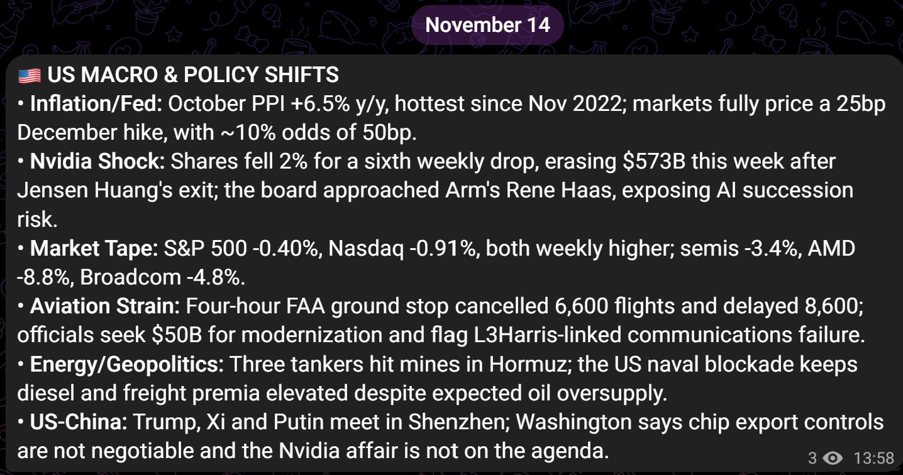
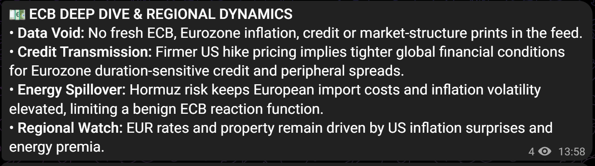
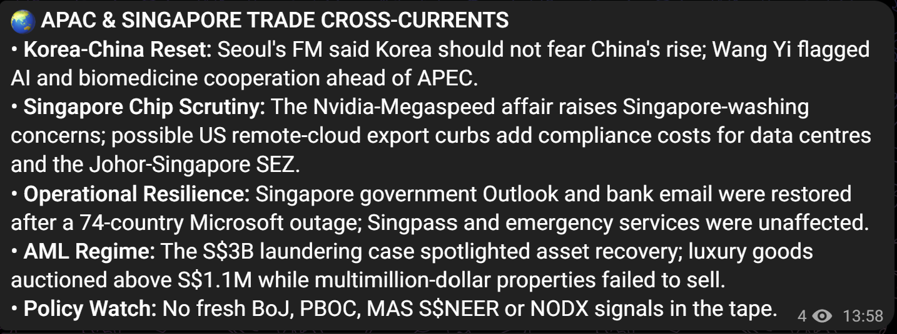
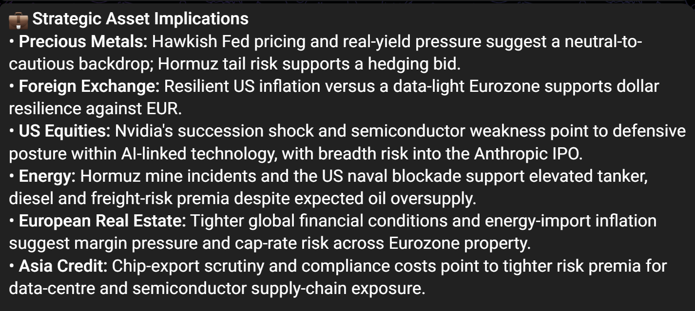
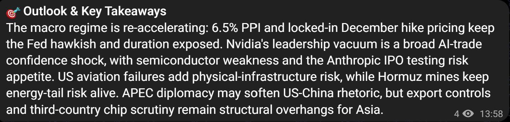
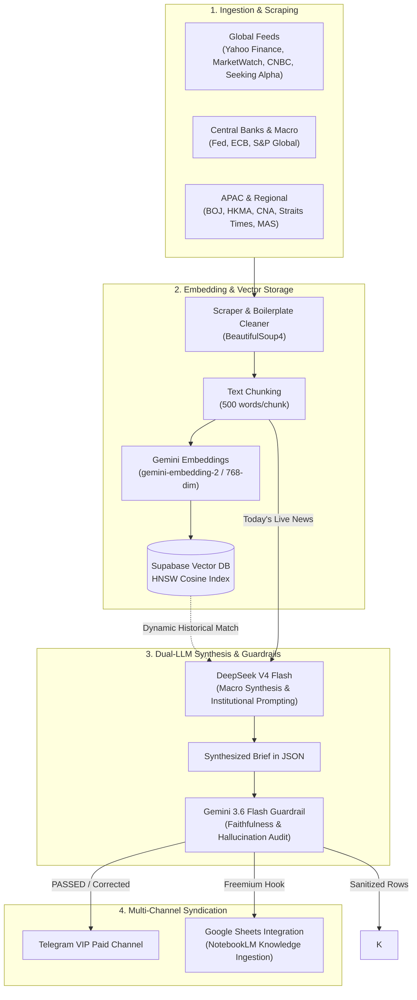

[](https://www.python.org/)

An autonomous, macroeconomic intelligence pipeline. It continuously ingests latest RSS feeds from global central banks and tier-1 financial publishers, stores chunked content as high-dimensional vector embeddings in Supabase (`pgvector`), retrieves relevant historical context via RAG, synthesizes actionable market briefs via DeepSeek, and fact-checks candidate briefs with Google Gemini before broadcasting across Telegram channels and Google Sheets.


<div style="display: flex; gap: 12px; justify-content: center; align-items: flex-start; flex-wrap: wrap; margin: 1.5rem 0;">
  
  
  
</div>



---

## 📡 Access the Live Intelligence Feed

> [!TIP]
> ### Want Real-Time Daily Macro Insights?
> This automated intelligence synthesis runs live 3x daily across APAC, London, and US market opens and broadcasts directly to a private Telegram channel.
>
> 🔒 **Access is curated for busy professionals who invest, but lack the time to track global macroeconomics.**
> 
> To request an invitation:
> 1. Follow / connect with me on [LinkedIn](https://www.linkedin.com/in/weicheng-alan-ong-cissp-cism-gmle-gcfa-gaips-gcti-73435298)
> 2. Send me a direct message with a brief note referencing **"AIxSEC - Daily Macro Telegram"**.
> 3. I'll personally share the private channel invite link!
---

## 📑 Table of Contents

- [System Architecture](#-system-architecture)
- [Key Features](#-key-features)
- [Broadcast Sections & MAS Compliance](#-broadcast-sections--mas-compliance)
- [Repository Structure](#-repository-structure)
- [GitHub Actions Scheduled Automation](#-github-actions-scheduled-automation)

---

## 🏛 System Architecture



---

## 🚀 Key Features

- **Multi-Region Feed Aggregation**: Monitored feeds span US Wall Street, European Central Bank updates, Bank of Japan announcements, Hong Kong Monetary Authority, and Singapore (MAS).
- **Automated Fallback Windows**: Primary sweep targets an 8-hour publication window, auto-expanding to 24–48 hours across weekend market closures.
- **RAG via pgvector & HNSW**: Ingested articles are embedded into 768-dimensional vectors using `gemini-embedding-2` and matched against historical precedents with cosine similarity (`match_historical_news`).
- **Synthesis Engine**: DeepSeek analyzes incoming market news, removes duplicate stories across regions, highlights conflicting global economic trends, and formats the brief so it publishes cleanly to Telegram without display errors.
- **Faithfulness Guardrail**: An automated fact-checking layer via `gemini-3.6-flash` audits metrics, flags hallucinated percentage rates or unverified claims, and prunes consumer fluff before delivery.
- **Google Sheets & NotebookLM Sync**: Archive daily insights into Google Sheets for instant NotebookLM audio/research generation.
- **Database Hygiene**: Automatic purging routine removes stale vector embeddings older than 30 days to optimize storage quotas.

---

## 📊 Broadcast Sections & MAS Compliance

Each generated brief strictly adheres to a 5-part breakdown:

| Section Key | Coverage |
| :--- | :--- |
| `us_macro` | Federal Reserve rate policy, treasury yields, US indicators, and trade/tech policy. |
| `ecb_deep_dive` | Eurozone credit conditions, ECB policy updates, European sovereign bond spreads. |
| `apac_singapore` | Bank of Japan policy shifts, PBOC measures, MAS monetary policy stance, and Singapore NODX. |
| `outlook_takeaways` | Dense macroeconomic takeaways (strictly 3–4 sentences). |
| `asset_implications` | Neutral, MAS-compliant institutional capital implications across asset classes. |

> [!IMPORTANT]
> **MAS Compliance Guardrail**: In compliance with Monetary Authority of Singapore (MAS) regulations, the system strictly forbids directional retail trade verbs (`Buy`, `Sell`, `Long`, `Short`). Instead, descriptive institutional risk language is enforced (e.g., *"favors a positive outlook for..."*, *"suggests margin pressure across..."*). Every broadcast includes an educational disclaimer.

---

## 📂 Repository Structure

```
.
├── .github/
│   └── workflows/
│       └── schedule.yml          # GitHub Actions 3x daily cron & manual dispatch
├── database.py                   # Supabase client, vector queries, hygiene & RPC
├── main.py                       # Core pipeline (ingestion, RAG, DeepSeek, Gemini, distribution)
├── requirements.txt              # Production dependencies
└── README.md                     # Project documentation
```

---

## 🛠 Prerequisites & Stack

- **Runtime**: Python 3.11+
- **Database**: [Supabase](https://supabase.com/) with `pgvector` enabled
- **LLM APIs**:
  - [DeepSeek API](https://platform.deepseek.com/) (Synthesis via `deepseek-v4-flash`)
  - [Google Gemini API](https://aistudio.google.com/) (`gemini-embedding-2` for vectors, `gemini-3.6-flash` for audit)
- **Messaging & Export**: Telegram Bot API, Google Sheets API (`gspread`)

---

## ⏰ GitHub Actions Scheduled Automation

The pipeline is pre-configured to execute in headless mode on Ubuntu via [`.github/workflows/schedule.yml`](file:///.github/workflows/schedule.yml).

### Execution Schedule
The broadcast runs three times daily aligned with key global financial market opens:

| UTC Time | SGT (UTC+8) | Market Milestone |
| :--- | :--- | :--- |
| `00:00 UTC` | 08:00 AM SGT | APAC & Singapore Cash Market Open |
| `07:00 UTC` | 03:00 PM SGT | London & European Market Open |
| `13:00 UTC` | 09:00 PM SGT | US Wall Street Pre-Market & Data Release |
